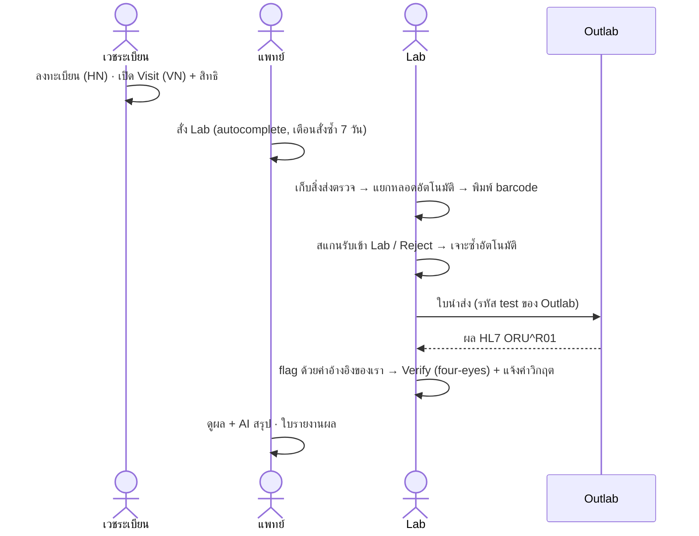
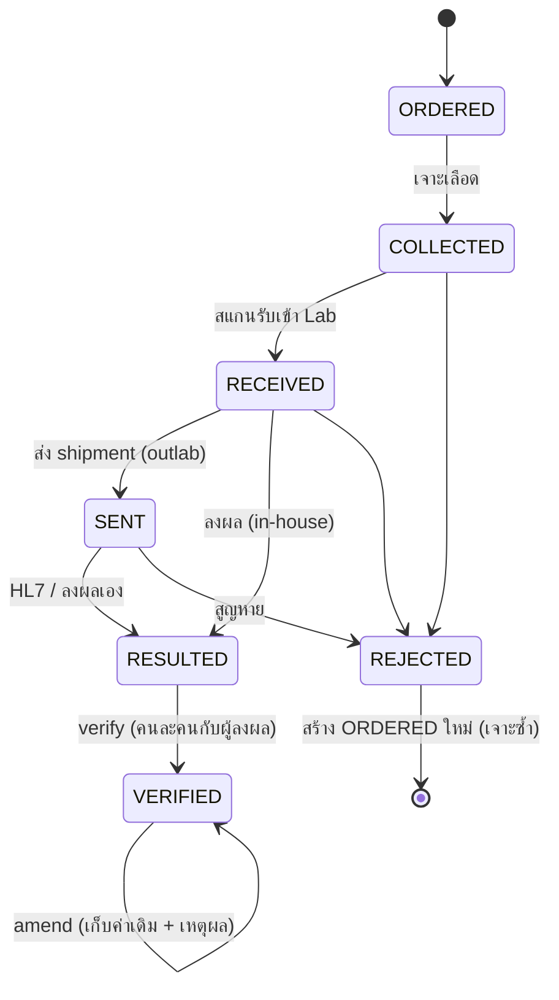

# Mini HIS · LIS Outlab

ระบบโรงพยาบาลขนาดเล็กที่เน้น **งานห้องปฏิบัติการส่งตรวจภายนอก (Outlab)** ครบวงจร ตั้งแต่แพทย์สั่ง Lab, เจาะเลือด, ส่งหลอดให้ Outlab, รับผลกลับทาง HL7, verify แบบ four-eyes ไปจนถึงรายงานผลพร้อม **AI สรุปผลให้แพทย์**

> โปรเจกต์ portfolio ข้อมูลผู้ป่วย แพทย์ และ Outlab ทั้งหมดเป็นข้อมูลสมมติ

## ทำไมต้อง Outlab

test เฉพาะทางหลายตัว (TSH, Vitamin D, tumor marker) โรงพยาบาลส่งไปตรวจที่ Lab ภายนอก ช่วงที่หลอดเลือดออกจากโรงพยาบาลไปแล้วคือจุดที่ข้อมูลหายง่ายที่สุด เช่น หลอดอยู่ที่ไหน ส่งไปกับใบนำส่งไหน ผลกลับมาครบหรือยัง หรือผลที่ outlab ส่งมาตรงกับหลอดไหน ระบบนี้ตามรอยทุกหลอดด้วย accession barcode และ shipment

## Flow



### สถานะของแต่ละ test



### Data model (ตารางหลัก)

```mermaid
erDiagram
  patients ||--o{ visits : has
  visits ||--o{ lab_orders : has
  lab_orders ||--o{ lab_order_items : "1 row per test"
  lab_orders ||--o{ specimens : "tubes"
  specimens ||--o{ lab_order_items : "tests in tube"
  shipments ||--o{ specimens : manifest
  outlabs ||--o{ shipments : to
  outlabs ||--o{ lab_tests : "performs (code mapping)"
  lab_tests ||--o{ lab_order_items : is
  inbound_messages ||--o{ lab_order_items : "HL7 source"
  lab_order_items ||--o{ result_amendments : history
  lab_order_items ||--o{ critical_notifications : "phone log"
```

schema เต็มอยู่ที่ [`db/schema.sql`](db/schema.sql)

## วิธีรัน

ต้องมี Node.js 24 ขึ้นไป (ใช้ `node:sqlite` ที่ติดมากับ Node ไม่ต้องติดตั้ง database)

```bash
npm install
npm run dev          # http://localhost:3000  (DB + ข้อมูลตัวอย่างถูกสร้างเองตอนเปิดครั้งแรก)
npm run db:reset     # ล้าง DB (หยุด dev server ก่อน)
```

ผู้ใช้เดโม (หน้า login เลือกได้เลย ไม่มีรหัสผ่าน):

| ผู้ใช้ | บทบาท |
|---|---|
| สมใจ | CLERK เวชระเบียน |
| นพ.ธนา | DOCTOR |
| นางสาวพิมพ์ / ทนพ.สมศักดิ์ | LAB (2 คน ใช้สาธิต four-eyes) |
| ผู้ดูแลระบบ | ADMIN (Audit log) |

**AI สรุปผล** ใช้ Claude API ใส่ key ใน `.env.local`:

```
ANTHROPIC_API_KEY=sk-ant-...
```

ถ้าไม่มี key หรือ API ล่ม ระบบยังใช้งานได้ปกติ และแสดงสรุปแบบกฎแทน

## ทดสอบ

```bash
npm test                      # unit test: flag ผล, เลขบัตรประชาชน, แยกหลอด, HL7 parser, AI guardrail
npm run build && npm run smoke  # end-to-end 60+ checks บน DB ชั่วคราว (ไม่แตะ DB จริง)
```

`smoke` ยิง HTTP แบบเดียวกับเบราว์เซอร์ที่ไม่มี JS ครอบคลุม flow หลักและกรณีผิดปกติ: สแกนซ้ำ, reject ซ้ำ, ส่ง shipment ซ้ำ, import HL7 ซ้ำ, outlab ปลอมตัว, verify ผลที่ตัวเองลง, ค่าวิกฤตที่ไม่ได้บันทึกการแจ้ง, ผู้ใช้ผิด role ยิง action ตรงๆ, cookie ปลอม

## Design decisions

| เรื่อง | ตัดสินใจ | เหตุผล |
|---|---|---|
| Flag ผล | คำนวณใหม่จากค่าอ้างอิงของโรงพยาบาลเรา ไม่ใช้ flag ที่ outlab ส่งมา | ค่าอ้างอิงขึ้นกับประชากรและวิธีตรวจของแต่ละที่ |
| ค่าวิกฤต | verify ไม่ได้ถ้ายังไม่บันทึกว่าแจ้งใคร ทางไหน | มาตรฐาน HA กำหนดให้รายงานค่าวิกฤตและมีหลักฐาน |
| Four-eyes | ผู้ลงผลกับผู้ verify ต้องเป็นคนละคน ผลจาก HL7 นับ outlab เป็นคนที่หนึ่ง | ลดความผิดพลาดจากคนเดียว |
| HL7 import | idempotent ด้วย MSH-10, outlab ส่งผลได้เฉพาะ test ของตัวเอง, ไม่มีผลที่ตรงเลยให้ rollback | ไฟล์ถูกส่งซ้ำบ่อยในงานจริง |
| แก้ผล | ไม่ลบค่าเดิม เก็บใน `result_amendments` พร้อมเหตุผล ใบรายงานขึ้นว่า "แก้ไข" | ตรวจสอบย้อนหลังได้ |
| แพทย์เห็นผล | เฉพาะผลที่ verify แล้ว | ผลที่ยังไม่ verify ยังไม่ใช่ข้อเท็จจริง |
| AI | ส่งเฉพาะเพศ อายุ และผลที่ verify แล้ว (de-identified), ห้ามวินิจฉัย, ตรวจว่าทุกตัวเลขที่ AI เขียนมีอยู่ในข้อมูลจริง, บันทึกใน audit, ล่มแล้วใช้สรุปแบบกฎ | PDPA และความปลอดภัยของผู้ป่วย |
| Autocomplete สั่ง Lab | ไม่ใช้ AI เรียงตาม test ที่แพทย์คนนั้นสั่งบ่อย | เร็ว ฟรี และคาดเดาผลได้ |
| เลขรัน HN/VN/Accession | `INSERT ... ON CONFLICT DO UPDATE ... RETURNING` | atomic ไม่ชนกันแม้กดพร้อมกัน (ไม่ใช้ `MAX()+1`) |
| สิทธิ์ | ตรวจใน server action ทุกตัว ปุ่มที่ซ่อนมีไว้เพื่อ UX เท่านั้น, ถูกปฏิเสธแล้วบันทึก `DENY` | server action ถูกเรียกตรงได้ |
| Error | ผิดกฎธุรกิจแสดงเป็นข้อความบนหน้าเดิม และ transaction rollback ส่วนบั๊กจริงไปหน้า error พร้อมรหัสอ้างอิง | ผู้ใช้หน้างานต้องรู้ว่าต้องทำอะไรต่อ |
| Database | SQLite (`node:sqlite`) + SQL ตรงๆ ไม่ใช้ ORM | clone แล้วรันได้ทันที SQL อ่านและอธิบายง่าย |

## ถ้าจะขึ้น production

- PostgreSQL (schema เป็น SQL มาตรฐาน แก้ไม่มาก) และ connection pool
- Login จริงผ่าน SSO / LDAP ของโรงพยาบาล
- รับ HL7 ผ่าน MLLP/SFTP แทนการอัปโหลด, รองรับ ORU status `C` (corrected), ส่ง ORM ไป outlab
- FHIR API: map เป็น `ServiceRequest` / `Specimen` / `Observation` / `DiagnosticReport`
- กระทบยอดใบแจ้งหนี้รายเดือนของ outlab กับ shipment
- Patient portal: คนไข้ดูผลของตัวเองพร้อมคำอธิบายภาษาง่าย (แพทย์เป็นคนกดปล่อยผลที่อ่อนไหว)

## โครงสร้าง

```
db/schema.sql            schema ทั้งหมด
src/lib/                 db, auth, rules (pure logic + unit test), hl7, ai
src/app/patients/        ลงทะเบียน, visit, ผล + AI สรุป
src/app/visits/[vn]/     สั่ง Lab
src/app/lab/             collect, receive, shipments, results, verify
src/app/reports/         ใบรายงานผล + amend
src/app/admin/audit/     audit log
scripts/smoke.mjs        end-to-end test
```

Stack: Next.js 16 (App Router, Server Actions) · TypeScript · Tailwind CSS 4 · SQLite (`node:sqlite`) · Zod · JsBarcode · Claude API
